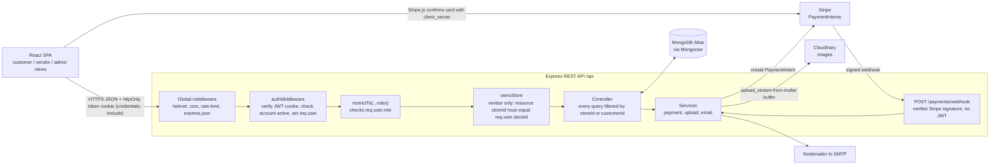
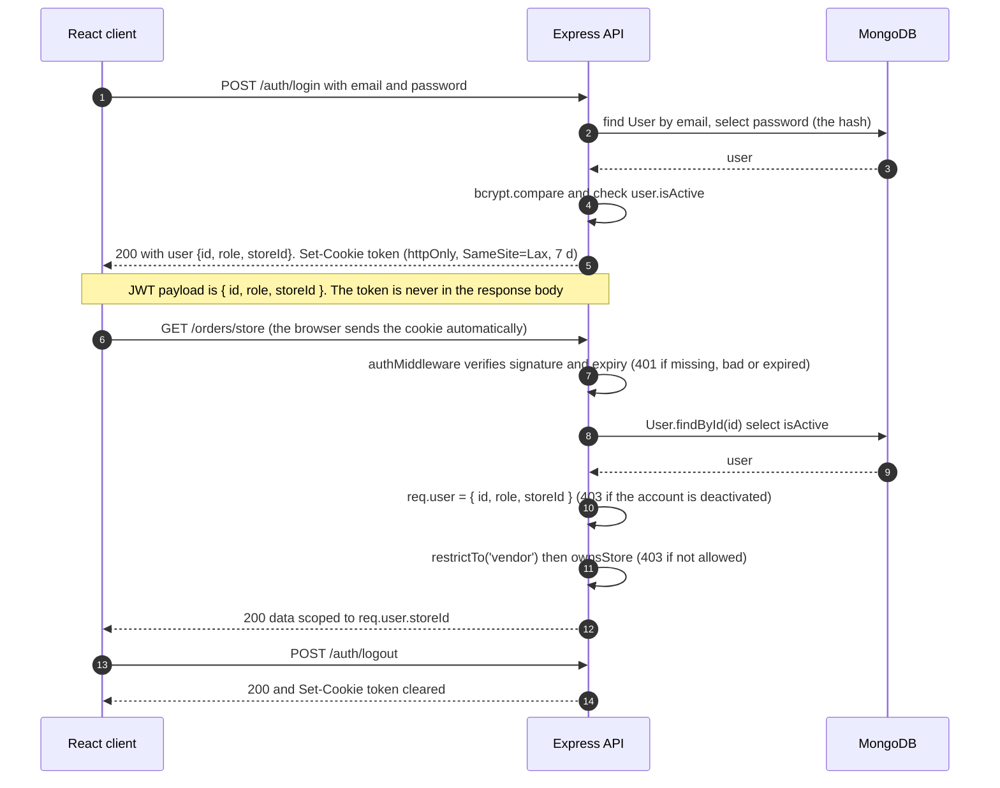
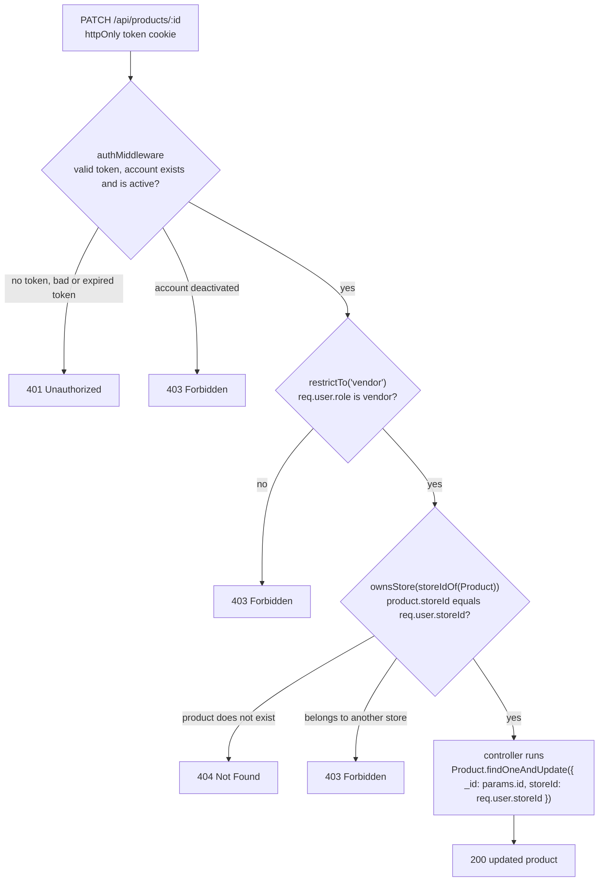
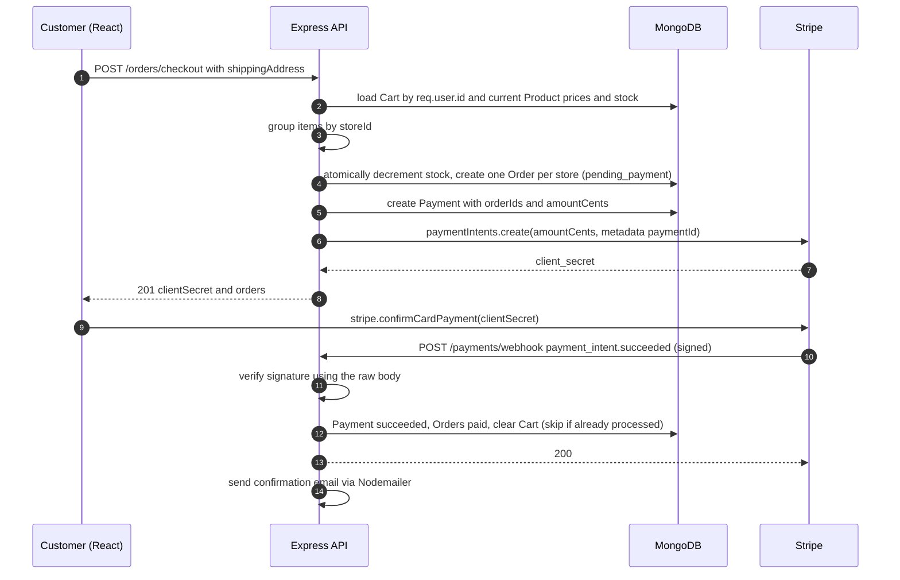

# Multi-Tenant E-Commerce SaaS — Day 1 Reference

**Stack:** Node.js · Express · MongoDB/Mongoose · JWT · Stripe · Cloudinary · Nodemailer · React
**Roles:** Vendor (owns one store) · Customer (shops across stores) · Super Admin (oversees all tenants)
**Audience:** Person A (leads) and Person B (builds Day 2 DB schema from this without a live walkthrough)

> ### Day 2 amendments: where the schemas in `server/src/models/` win over this document
> - **Vendor registration creates the User and the Store together** (ids pre-generated; see Day 4 for how), so a vendor never exists without a `storeId`. There is no "vendor with no store yet" state and no `POST /stores` for a new vendor.
> - **Store:** the `status` enum (`pending|active|suspended`) is now a boolean `isActive` (default `true`, so the admin-approval gate is off by default; set the default to `false` to restore it).
> - **Product:** `status` (`draft|active|archived`) is now `isActive`. `priceCents` is now `price` (**still integer cents**). `images` are plain URL strings. `variants` (size/colour, each with its own `stock`) were added. `category` is a lowercase string, and there is no Category model yet.
> - **Order:** statuses are `pending|paid|shipped|delivered|cancelled` (`pending_payment` is now `pending`, `processing` is dropped). `totalCents` is now `totalAmount` (still cents). `paymentIntentId` lives on the Order and is **shared by all orders from one checkout**, so the **Payment model is dropped for v1**. Items also carry optional `variantId` and `variantLabel`. `orderNumber`, `statusHistory` and `trackingNumber` are not in the schema yet.
> - **Not built on Day 2:** Category, Cart and Payment. Everything else here (one Order per store, route matrix) stands; the auth design was revised on Day 5 (below).
>
> ### Day 3 amendments
> - The error class is **`AppError(statusCode, message, errors?)`** in `utils/app-error.js` (Day 1 called it `ApiError`). Express 5 is installed, so async handlers need **no `asyncHandler`** wrapper. The error middleware also converts Mongoose validation/cast errors, duplicate keys, JWT errors and bad JSON into clean 4xx responses.
> - `GET /api/health` is defined directly in `app.js`; resource routers are mounted in `routes/index.js` (base path: see Day 4).
> - The morgan logger sits **before** the body parsers, not after, so malformed requests are still logged.
>
> ### Day 4 amendments (auth)
> - **The API base is `/api`, with no `/v1`**, to match the agreed URLs (`/api/health`, `/api/auth/register`, `/api/auth/me`). Read every `/api/v1/...` below as `/api/...`. To bring versioning back, change one line in `app.js`.
> - **The User password field is `password`, not `passwordHash`.** It holds a bcrypt hash once saved; a `pre('save')` hook in the model does the hashing, only when the password is new or changed. Full details are in [day-4-auth-api.md](day-4-auth-api.md).
> - **Vendor registration takes a `storeName`** and creates the Store right there (slug derived from the name). It is **not** a transaction (a plain local `mongod` can't run them): the Store is inserted first and deleted again if the User insert fails.
> - **Mongoose 9:** use `{ returnDocument: 'after' }` instead of `{ new: true }` on `findOneAndUpdate`.
> - Input validation uses **Zod** (`validators/` + `middleware/validate.middleware.js`). A bad body returns `400 { success: false, message: 'Validation failed', errors: { field: message } }`.
>
> ### Day 5 amendments (JWT + RBAC): these replace the auth design in §2.2 and §2.3 above
> - **Renamed:** `protect` → **`authMiddleware`**, `authorize(...)` → **`restrictTo(...)`**. **`requireStore` and `req.storeId` are gone**: use `req.user.storeId`. New **`ownsStore`** is the tenant check. Files: `middleware/auth.middleware.js` and `middleware/rbac.middleware.js`. See [day-5-auth-rbac.md](day-5-auth-rbac.md).
> - **One 7-day token, no refresh token,** delivered in an **httpOnly cookie** (never in the response body). Payload `{ id, role, storeId }`. There is no `/auth/refresh` and no `Authorization: Bearer` header.
> - **Cross-tenant access is 403, not 404** (Day 1 said 404). 404 now only means the resource doesn't exist.
> - `POST /api/auth/logout` exists because an httpOnly cookie can't be cleared by frontend JS.
> - Not enforced anywhere yet: **`Store.isActive`** (a suspended store's vendor can still write). Add it to the Week 2 Store work.

> ## The one rule the sprint depends on
> **A tenant is a Store. `storeId` = `Store._id`.**
> It lives on exactly these collections: **Product.storeId** and **Order.storeId** (the tenant-scoped data), plus **User.storeId** (vendor → their store pointer) and **Cart.items[].storeId** (denormalised, grouping only).
> Everything else is either the tenant itself (Store), global (Category), or scoped by customer (Cart, Payment).
> A vendor's `storeId` **only ever comes from the signed token** (`req.user.storeId`), never from body, params or query.

---

## 1. Requirement analysis

Priority: **M** = must ship in 4 weeks, **S** = stretch.

### 1.1 Vendor — "As a vendor, I can…"

| ID | Story | Pri |
|----|-------|-----|
| V-1 | Register with email + password as a vendor, log in, log out, reset a forgotten password | M |
| V-2 | Create my store (name, slug, description, logo, contact email). It starts `pending` until an admin approves it | M |
| V-3 | Edit my store profile | M |
| V-4 | Create a product (name, description, price, stock, category, up to 5 images) | M |
| V-5 | Edit, publish/unpublish (`draft`/`active`) and archive my products; never see other vendors' products | M |
| V-6 | Upload product images (stored on Cloudinary under my store's folder) | M |
| V-7 | See a list of orders that contain my products, filter by status | M |
| V-8 | Move an order through `processing → shipped → delivered` and add a tracking number | M |
| V-9 | See a simple dashboard: order count, revenue, low-stock products | S |
| V-10 | Get an email when I receive a new paid order | S |

### 1.2 Customer — "As a customer, I can…"

| ID | Story | Pri |
|----|-------|-----|
| C-1 | Register/log in/log out/reset password | M |
| C-2 | Browse products from all active stores; search by text; filter by category, store, price; sort; paginate | M |
| C-3 | View a product page and the store that sells it | M |
| C-4 | Add/update/remove items in a cart that can hold items from several stores | M |
| C-5 | Check out: enter a shipping address, pay by card via Stripe | M |
| C-6 | See one confirmation covering all stores I bought from (one payment, one order per store) | M |
| C-7 | List my orders and see each order's status and tracking number | M |
| C-8 | Cancel an order that has not started processing | S |
| C-9 | Get emails: welcome, order confirmation, shipped | M |
| C-10 | Rate/review a product | S |

### 1.3 Super Admin — "As an admin, I can…"

| ID | Story | Pri |
|----|-------|-----|
| A-1 | Log in with an admin account (created by seed script, never via public registration) | M |
| A-2 | List all stores; approve, suspend or reactivate a store | M |
| A-3 | List all users; deactivate/reactivate an account | M |
| A-4 | View all orders and payments across every store, filter by `storeId` | M |
| A-5 | Manage the global category list (CRUD) | M |
| A-6 | See platform stats: stores, users, orders, gross sales | M |
| A-7 | Remove/unpublish any product | S |

### 1.4 Assumptions (challenge these on Day 1, not Day 12)

1. **One vendor user = one store** (1:1). No staff accounts under a store in v1.
2. **Store approval gate:** a new store is `pending` and invisible publicly until an admin sets it `active`. A `suspended` store's products vanish from the catalog and its vendor can't write.
3. **Customers are platform-level**, not tied to any store. One cart may hold items from many stores.
4. **One order per store.** A checkout with items from 3 stores creates 3 `Order` documents under 1 `Payment`. This is what keeps `Order.storeId` a single clean value.
5. **Money:** single currency (USD), stored as **integer cents**. The platform's single Stripe account collects all payments. **Vendor payouts/commission/Stripe Connect are out of scope** (stretch).
6. **Categories are global** and admin-managed; vendors pick from them.
7. **No product variants** (size/colour) in v1. One product = one price = one stock count.
8. **Products are archived, never hard-deleted** (orders reference them; orders also snapshot name/price).
9. **Cart requires login** (server-side cart). Guest cart is stretch.
10. **Shipping:** no carrier integration, flat/free shipping. The vendor types a tracking number.
11. **Refunds** are handled manually in the Stripe dashboard in v1.
12. **Email verification** is stretch. Password reset and transactional emails are in scope.
13. **Admins are seeded** (`scripts/seed-admin.js`). Registration accepts only `customer` or `vendor`.

**Out of scope:** coupons, wishlists, guest checkout, multi-currency, real-time notifications, per-store custom domains, vendor payouts.

---

## 2. System architecture

### 2.1 Component view



Where the integrations plug in:

| Service | Plugs in at | Rule |
|---|---|---|
| **Cloudinary** | `upload.middleware.js` (multer, memory storage, 5 MB, images only) → `upload.service.js` | Folder `stores/{storeId}/products`. Save `{url, publicId}` on the product. Delete by `publicId` when an image is removed |
| **Stripe** | `payment.service.js`, called from `order.controller.checkout`; webhook in `payment.routes.js` | Server computes the amount from DB prices. Card data never touches our server (Stripe.js). **Only the webhook marks orders `paid`** |
| **Nodemailer** | `email.service.js` | Fire-and-forget after DB writes; never block or fail a request on email |

The webhook route must be mounted **before** `express.json()` using `express.raw({ type: 'application/json' })`, otherwise signature verification fails.

### 2.2 JWT auth flow



Why the payload carries `role` and `storeId`: both are **immutable** on the User model (Day 2) and a vendor's `storeId` exists from registration (Day 4), so neither can go stale inside a token. The one thing that *can* change is `isActive` (an admin bans someone), so `authMiddleware` makes one small read by `_id` per request; a ban takes effect on the next request instead of after 7 days. There is **one 7-day token and no refresh token**; the login response body is unchanged, and the frontend must send credentials (`credentials: 'include'` / `withCredentials: true`). Rationale and the cross-site deployment caveat are at the top of `server/src/utils/token.js`.

### 2.3 How multi-tenancy is enforced

Model: **one database, shared collections, a `storeId` discriminator** (not a database per tenant). Cross-store browsing is a core feature, and a DB-per-tenant model would make it painful.



**Rules (each is a review-checklist item):**

1. **`storeId` comes from `req.user.storeId` only.** It is in the signed token, so a client can't change it. Never read `storeId` from `req.body`, `req.params` or `req.query` on a vendor route (the one exception: `ownsStore()` *compares* a `:storeId` URL param against `req.user.storeId`, it never trusts it).
2. **Writes stamp it:** `Product.create({ ...req.body, storeId: req.user.storeId })`. The schema field is `immutable: true`, and Zod schemas are `.strict()` so a client-sent `storeId` is rejected.
3. **Guard the boundary twice.** `ownsStore(...)` runs before the controller, and the controller's own query is scoped too: `findOne({ _id, storeId: req.user.storeId })`, `findOneAndUpdate({ _id, storeId }, …)`, `deleteOne({ _id, storeId })`. The middleware check-then-act is safe because `storeId` is immutable; the scoped query is the backstop if someone forgets the middleware.
4. **Cross-tenant access returns 403** (`ownsStore`: logged in but not allowed) and a nonexistent resource returns 404. Trade-off: a vendor can tell that an id exists in another store; ObjectIds aren't secrets, so we accept it for clear errors. 401 always means "we don't know who you are", never "not allowed".
5. **Aggregations:** `$match: { storeId }` is the first stage, and the id must be cast (`new mongoose.Types.ObjectId(req.user.storeId)`); aggregate does not auto-cast.
6. **Every vendor route has a two-vendor test:** vendor B tries to read/update/delete vendor A's document and must get 403.

Who is filtered by what:

| Caller | Automatic filter | Where it comes from |
|---|---|---|
| **Vendor** | `{ storeId: req.user.storeId }` on Product and Order | `authMiddleware` + `ownsStore` |
| **Customer** | `{ customerId: req.user.id }` on Cart, Order, Payment. Catalog reads span all stores | `authMiddleware` |
| **Public** (no login) | Products with `status: 'active'` whose store is `active` | catalog controller |
| **Admin** | None. `ownsStore` lets admins through; may pass an explicit `?storeId=` to narrow | `restrictTo('admin')` |

Product visibility = `product.status === 'active'` **and** `store.status === 'active'`. The catalog controller resolves active store ids first (`Store.distinct('_id', { status: 'active' })`) and uses `storeId: { $in: ids }`. Cache it later if it shows up in profiling.

### 2.4 Where `storeId` lives in every collection

```mermaid
erDiagram
    USER ||--o| STORE : "owns (vendor only)"
    STORE ||--o{ PRODUCT : "sells"
    STORE ||--o{ ORDER : "receives"
    USER ||--o{ ORDER : "places (customer)"
    USER ||--o| CART : "has (customer)"
    USER ||--o{ PAYMENT : "pays"
    CATEGORY ||--o{ PRODUCT : "classifies"
    PAYMENT ||--|{ ORDER : "covers one or more orders"
    ORDER ||--|{ ORDER_ITEM : "embeds"
    CART ||--o{ CART_ITEM : "embeds"
    PRODUCT ||--o{ ORDER_ITEM : "snapshotted into"
    PRODUCT ||--o{ CART_ITEM : "referenced by"

    USER {
        ObjectId _id PK
        string email UK
        string role "customer, vendor, admin"
        ObjectId storeId FK "NULLABLE. Vendors only. Set when the store is created"
    }
    STORE {
        ObjectId _id PK "THIS IS the storeId"
        ObjectId ownerId FK "unique, one store per vendor"
        string slug UK
        string status "pending, active, suspended"
    }
    CATEGORY {
        ObjectId _id PK
        string slug UK
        boolean isActive "GLOBAL. No storeId"
    }
    PRODUCT {
        ObjectId _id PK
        ObjectId storeId FK "TENANT KEY. required, immutable, indexed"
        ObjectId categoryId FK
        int priceCents
        int stock
        string status "draft, active, archived"
    }
    CART {
        ObjectId _id PK
        ObjectId customerId FK "unique. No top-level storeId"
    }
    CART_ITEM {
        ObjectId productId FK
        ObjectId storeId FK "denormalised from product, for grouping at checkout only"
        int quantity
    }
    ORDER {
        ObjectId _id PK
        ObjectId storeId FK "TENANT KEY. required, indexed. One order equals one store"
        ObjectId customerId FK
        ObjectId paymentId FK
        string status
        int totalCents
    }
    ORDER_ITEM {
        ObjectId productId FK "no storeId, inherited from the parent order"
        string name "snapshot"
        int priceCents "snapshot"
        int quantity
    }
    PAYMENT {
        ObjectId _id PK
        ObjectId customerId FK "spans stores, so NO storeId"
        string stripePaymentIntentId UK
        string status
    }
```



| Collection | `storeId`? | Notes |
|---|---|---|
| **User** | Yes, nullable | Vendors only, set in the same step that creates their Store. `Store.ownerId` (unique) is the source of truth; `User.storeId` is a denormalised pointer so auth needs no extra query |
| **Store** | No field: `_id` **is** the storeId | The tenant itself |
| **Category** | No | Global |
| **Product** | **Yes, required** | Tenant key. Immutable |
| **Cart** | No at top level | Scoped by `customerId`. `items[].storeId` is copied from the product so checkout can group by store |
| **Order** | **Yes, required** | Tenant key. One order = one store. Also has `customerId` |
| **Order.items[]** | No | Inherits from the parent order |
| **Payment** | No | Spans several stores. Holds `orderIds[]` and `customerId` |

### 2.5 Checkout and payment flow



- **Never trust client prices.** The server recomputes every line from the DB.
- **Stock:** `Product.updateOne({ _id, stock: { $gte: qty } }, { $inc: { stock: -qty } })`. If `matchedCount` is 0, fail the checkout. `payment_intent.payment_failed`/`canceled` cancels the orders and restocks. Expiring abandoned `pending_payment` orders (~30 min) is a Week 3 item.
- **Webhooks must be idempotent** (Stripe retries): if the Payment is already `succeeded`, return 200 and do nothing.
- **Order status machine:** `pending_payment → paid → processing → shipped → delivered`; `cancelled` from `pending_payment` or `paid`. Vendors may only move `paid → processing → shipped → delivered`. Record every change in `statusHistory`.

### 2.6 Collections reference (input to Day 2)

Conventions: field names camelCase; `timestamps: true` on all; money = integer cents (`priceCents`); ref fields end in `Id`; enums come from `utils/constants.js`.

| Model | Fields | Indexes |
|---|---|---|
| **User** | `name`, `email` (lowercase), `password` (bcrypt hash, `select: false`), `role` (`customer\|vendor\|admin`), `storeId` (ref Store, absent unless vendor), `isActive` (default true), `resetTokenHash`, `resetTokenExpires` (password reset, not built yet) | `email` unique · `storeId` sparse |
| **Store** | `ownerId` (ref User), `name`, `slug`, `description`, `logo {url, publicId}`, `contactEmail`, `status` (`pending\|active\|suspended`, default `pending`) | `slug` unique · `ownerId` unique · `status` |
| **Category** | `name`, `slug`, `isActive` | `slug` unique |
| **Product** | `storeId` (immutable), `categoryId`, `name`, `slug`, `description`, `priceCents`, `currency` (`usd`), `stock`, `images [{url, publicId}]`, `status` (`draft\|active\|archived`) | `{storeId, slug}` unique · `{storeId, status, createdAt}` · `{categoryId, status}` · text on `name, description` |
| **Cart** | `customerId`, `items [{productId, storeId, quantity ≥ 1}]` (no prices stored; read fresh) | `customerId` unique |
| **Order** | `orderNumber`, `storeId`, `customerId`, `paymentId`, `items [{productId, name, priceCents, quantity, image}]` (snapshots), `subtotalCents`, `shippingCents`, `totalCents`, `shippingAddress {fullName, line1, line2, city, state, postalCode, country, phone}`, `status`, `statusHistory [{status, at, by}]`, `trackingNumber` | `orderNumber` unique · `{storeId, status, createdAt}` · `{customerId, createdAt}` · `paymentId` |
| **Payment** | `customerId`, `orderIds []`, `amountCents`, `currency`, `stripePaymentIntentId`, `status` (`requires_payment\|succeeded\|failed\|canceled`) | `stripePaymentIntentId` unique · `{customerId, createdAt}` |

Suggested Day 2 split: **Person A** → `user`, `store`, `product`; **Person B** → `category`, `cart`, `order`, `payment` (they only reference each other by ObjectId, so neither blocks the other).

### 2.7 Route → role matrix (base `/api`)

`P` = public · `C` customer · `V` vendor (`restrictTo('vendor')` + `ownsStore` where an id is in the URL) · `A` admin · `sig` = Stripe signature instead of JWT.

| File | Endpoint | Who |
|---|---|---|
| **auth** | `POST /auth/register` (role must be `customer` or `vendor`), `/login`, `/logout`, `/forgot-password`, `/reset-password`; `GET /auth/me` | P (`me`, `logout`: any logged-in) |
| **user** | `GET/PATCH /users/me` · `GET /users` · `PATCH /users/:id/status` | any · A · A |
| **store** | `POST /stores` (once) · `GET/PATCH /stores/mine` · `GET /stores`, `GET /stores/:slug` (active only) · `GET /stores/admin/all` · `PATCH /stores/:id/status` | V · V · P · A · A |
| **category** | `GET /categories` · `POST/PATCH/DELETE /categories/:id` | P · A |
| **product** | `GET /products`, `GET /products/:id` · `GET /products/mine` · `POST /products` · `PATCH/DELETE /products/:id` · `POST /products/:id/images` | P · V · V · V · V |
| **cart** | `GET /cart` · `POST /cart/items` · `PATCH/DELETE /cart/items/:productId` · `DELETE /cart` | C |
| **order** | `POST /orders/checkout`, `GET /orders/mine`, `GET /orders/mine/:id`, `POST /orders/mine/:id/cancel` · `GET /orders/store`, `GET /orders/store/:id`, `PATCH /orders/store/:id/status` · `GET /orders`, `GET /orders/:id` | C · V · A |
| **payment** | `POST /payments/webhook` · `GET /payments` | sig · A |
| **admin** | `GET /admin/stats` | A |

Explicit paths (`/orders/mine`, `/orders/store`) instead of one endpoint that branches on role, so each route has one audience and one filter. **Gotcha:** declare `/products/mine` **before** `/products/:id`, otherwise Express treats `mine` as an id.

---

## 3. Folder structure — `/server`

Rule: **one model = one routes file = one controller file** (plus one validator), so two people adding features almost never edit the same file.

```
Multi-E-Comerce-plaform/
├── client/                        # React app
├── docs/
│   └── day-1-architecture.md      # this file
└── server/
    ├── package.json
    ├── .env.example               # committed; .env is git-ignored
    ├── .gitignore
    ├── scripts/
    │   └── seed-admin.js          # creates the first super admin
    ├── tests/                     # mirrors src/ (e.g. tests/product.test.js)
    └── src/
        ├── server.js              # entry: load env, connect DB, app.listen
        ├── app.js                 # builds the Express app (no listen) so tests can import it
        │
        ├── config/                # wiring only, no business logic
        │   ├── env.js             # reads + validates process.env once; everyone imports from here
        │   ├── db.js              # mongoose.connect
        │   ├── cloudinary.js
        │   ├── stripe.js
        │   └── mailer.js          # Nodemailer transport
        │
        ├── models/                # ONE FILE PER COLLECTION
        │   ├── user.model.js
        │   ├── store.model.js
        │   ├── category.model.js
        │   ├── product.model.js
        │   ├── cart.model.js
        │   ├── order.model.js
        │   └── payment.model.js
        │
        ├── routes/                # URL → middleware chain → controller. No logic here
        │   ├── index.js           # mounts every router under /api
        │   ├── auth.routes.js     # (no model of its own; uses User)
        │   ├── user.routes.js
        │   ├── store.routes.js
        │   ├── category.routes.js
        │   ├── product.routes.js
        │   ├── cart.routes.js
        │   ├── order.routes.js
        │   ├── payment.routes.js
        │   └── admin.routes.js    # (no model; aggregate stats only)
        │
        ├── controllers/           # same names as routes; all business logic
        │   ├── auth.controller.js
        │   ├── user.controller.js
        │   ├── store.controller.js
        │   ├── category.controller.js
        │   ├── product.controller.js
        │   ├── cart.controller.js
        │   ├── order.controller.js
        │   ├── payment.controller.js
        │   └── admin.controller.js
        │
        ├── validators/            # Zod schemas, one per resource (.strict())
        │   └── product.validator.js   … etc.
        │
        ├── middleware/
        │   ├── auth.middleware.js     # authMiddleware (who is calling? 401)
        │   ├── rbac.middleware.js     # restrictTo(...roles), ownsStore, storeIdOf (allowed? 403)
        │   ├── validate.middleware.js # runs a Zod schema against body/query/params
        │   ├── upload.middleware.js   # multer (memory storage, limits, mime check)
        │   └── error.middleware.js    # notFound + central errorHandler
        │
        ├── services/              # third-party wrappers, called by controllers
        │   ├── payment.service.js     # Stripe
        │   ├── upload.service.js      # Cloudinary
        │   └── email.service.js       # Nodemailer templates
        │
        └── utils/                 # small pure helpers
            ├── app-error.js           # class AppError(statusCode, message, errors?)
            ├── constants.js           # ROLES, ORDER_STATUS (+ allowed transitions)
            ├── token.js               # sign/verify JWTs
            ├── pagination.js          # page/limit parsing
            └── slugify.js
```

Notes:
- We added `validators/`, `services/` and `tests/` to the six requested folders. Validators keep input rules out of controllers; services stop Stripe/Cloudinary calls from being copy-pasted into controllers.
- **Two files have no model of their own:** `auth.*` (works on User) and `admin.*` (aggregates). Everything else admin-only lives in the resource's own file behind `restrictTo('admin')`, e.g. `PATCH /stores/:id/status` is in `store.routes.js`.
- **Shared "hot" files** that both of you will eventually touch: `routes/index.js`, `app.js`, `utils/constants.js`, `package.json`. Change them in small, separate PRs and merge fast (see §4.4).
- **Module system: CommonJS** (`require`/`module.exports`). It has the least friction with Mongoose, Jest and most tutorials.

**Golden example** (copy this shape for every vendor-scoped controller):

```js
// controllers/product.controller.js
// Express 5 forwards errors thrown/rejected in async handlers to the error middleware,
// so there is no try/catch and no asyncHandler wrapper.
const createProduct = async (req, res) => {
  const product = await Product.create({ ...req.body, storeId: req.user.storeId });  // stamped from the token
  res.status(201).json({ success: true, data: product });
};

const updateProduct = async (req, res) => {
  const product = await Product.findOneAndUpdate(
    { _id: req.params.id, storeId: req.user.storeId },   // tenant filter lives inside the query
    req.body,                                       // Zod .strict(): storeId is not an allowed key
    { returnDocument: 'after', runValidators: true }
  );
  if (!product) throw new AppError(404, 'Product not found');
  res.json({ success: true, data: product });
};
```

```js
// routes/product.routes.js
router.get('/', listProducts);                                                    // public
router.get('/mine', authMiddleware, restrictTo(ROLES.VENDOR), listMine);          // before '/:id'
router.get('/:id', getProduct);
router.post('/', authMiddleware, restrictTo(ROLES.VENDOR), validate(createProductSchema), createProduct);
router.patch('/:id', authMiddleware, restrictTo(ROLES.VENDOR), ownsStore(storeIdOf(Product)), validate(updateProductSchema), updateProduct);
router.delete('/:id', authMiddleware, restrictTo(ROLES.VENDOR), ownsStore(storeIdOf(Product)), deleteProduct);
```

---

## 4. Coding conventions

### 4.1 Naming

| Thing | Convention | Example |
|---|---|---|
| Files | `kebab-case`, `<resource>.<layer>.js` | `product.controller.js`, `app-error.js` |
| Variables / functions | `camelCase` | `const activeStores` |
| Classes / Mongoose models / Zod schemas | `PascalCase` (models, classes) · `camelCase` + `Schema` (Zod) | `Product`, `AppError`, `createProductSchema` |
| Constants / env vars | `UPPER_SNAKE_CASE` | `ROLES.VENDOR`, `STRIPE_WEBHOOK_SECRET` |
| Controller functions | verb first, no `Controller` suffix | `createProduct`, `getMyOrders` |
| Booleans | `is/has/can` prefix | `isActive`, `hasStock` |
| DB fields | `camelCase`, refs end in `Id`, money ends in `Cents` | `storeId`, `customerId`, `priceCents` |
| The tenant key | **always exactly `storeId`**, never `store`, `shopId`, `vendorId` | |
| URLs | plural nouns, kebab-case | `/api/products/:id` |
| Enum values | lowercase snake | `pending_payment` |

**API responses:** success `{ success: true, data, message? }`; error `{ success: false, message, errors? }`.
**Status codes:** 400 validation · **401 we don't know who you are** (no/bad/expired token) · **403 we know who you are and the answer is no** (wrong role, someone else's store, deactivated account) · 404 not found · 409 duplicate · 422 business-rule failure (e.g. out of stock).
**Other:** async/await only (no `.then` chains, no try/catch just to forward errors: Express 5 does that); throw `AppError(statusCode, message)`, never `res.status(...).send` for errors; no `console.log` in committed code; secrets only in `.env`.

### 4.2 Git branches

- `main` — always deployable; only updated by merging `dev`, once a week after a smoke test.
- `dev` — integration branch. **Nobody pushes directly to `main` or `dev`.**
- Work branches, cut from `dev`, lowercase kebab-case, short:
  - `feature/product-crud`, `feature/stripe-checkout`
  - `fix/cart-total-rounding`
  - `chore/eslint-setup`, `docs/api-readme`, `test/tenant-isolation`

### 4.3 Commit messages (Conventional Commits)

```
<type>(<scope>): <imperative summary, ≤ 72 chars>

optional body: what and why, not how
```

- **type:** `feat` · `fix` · `docs` · `refactor` · `test` · `chore`
- **scope:** the resource / file base (`product`, `auth`, `order`, `config`)
- Examples: `feat(product): add vendor-scoped create endpoint` · `fix(cart): reject quantity below 1` · `test(product): cross-tenant update returns 403`
- PRs are **squash-merged**, and the PR title uses the same format, so `dev` history reads as one line per feature.

### 4.4 Two-person review habit

1. **Every PR into `dev` is looked at by the other person before it merges, even for 5 minutes.** Enforce it mechanically: GitHub branch protection on `dev` and `main` → require a PR + 1 approval.
2. **Author never merges their own unreviewed PR.** Reviewer responds within half a working day; if you're blocked, ping the other person. Only typo/docs PRs may self-merge, and you tell the other person.
3. **Keep PRs small** (one model or one feature, roughly under 300 changed lines). Small PRs get real reviews.
4. **The reviewer's 5-point glance:**
   - [ ] Every query on Product/Order uses `storeId` from `req.user.storeId`, inside the query?
   - [ ] Route has `authMiddleware` + the right `restrictTo(...)` (+ `ownsStore(...)` when an id is in the URL)?
   - [ ] Input validated with a `.strict()` Zod schema?
   - [ ] No secrets, no `console.log`, `.env.example` updated if a new var was added?
   - [ ] Does it actually run? (pull the branch and hit it once with Postman/curl for anything non-trivial)
5. **Daily sync:** `git pull origin dev` at the start of your day; merge `dev` into your branch before opening a PR. Post one message each morning: what you're working on and whether you're touching a shared file (`routes/index.js`, `app.js`, `constants.js`, `package.json`).
6. **Weekly:** on Friday both of you run the smoke path (register → create store → add product → cart → checkout → vendor ships order), then merge `dev` → `main`.

PR template (`.github/pull_request_template.md`):

```markdown
## What / why
## How to test
## Checklist
- [ ] storeId comes from req.user.storeId, inside the query
- [ ] authMiddleware + restrictTo (+ ownsStore) on new routes
- [ ] Zod .strict() validation
- [ ] No secrets / console.log; .env.example updated
- [ ] Touched a shared file? (routes/index.js, app.js, constants.js, package.json)
```

---

## 5. Decision log (walk Person B through these)

| # | Decision | Why | Revisit if |
|---|---|---|---|
| 1 | Shared DB, shared collections, `storeId` discriminator | Cross-store browsing is core; simplest on Atlas | A tenant needs data isolation/residency |
| 2 | One Order per store, grouped by one Payment | `Order.storeId` stays a single value; vendor queries are trivial | We adopt Stripe Connect (Payment splits per store) |
| 3 | JWT carries `{ id, role, storeId }` in a 7-day httpOnly cookie; `authMiddleware` re-checks `isActive` in the DB each request (Day 5) | `role`/`storeId` are immutable so can't go stale; bans still apply immediately; JS can't read the cookie | Frontend and API end up on different sites (cookie blocked), or we need to revoke roles mid-session |
| 4 | `storeId` only from `req.user.storeId`; `ownsStore` check **and** a scoped query; 403 on cross-tenant | Removes the whole class of "vendor A edits vendor B" bugs | — |
| 5 | Money as integer cents | No float rounding errors; matches Stripe | — |
| 6 | Platform Stripe account collects; webhook is the source of truth for `paid` | Simple; front-end can't fake payment | Vendor payouts become in-scope |
| 7 | Cloudinary upload through the server (multer) | One place to validate size/type and scope folders by store | Files get large → switch to signed direct upload |
| 8 | Store approval gate (`pending → active`) | Gives Admin real oversight | Too much friction for demo → default to `active` |
| 9 | Categories global, admin-managed | Consistent filters across stores | Vendors need custom categories |
| 10 | Archive products, never delete | Orders reference them | — |
| 11 | CommonJS, Zod, Jest | Least friction for a two-person team | — |

---

## 6. End-of-day sign-off

- [ ] Both point at the ER diagram (§2.4) and can say, for all 7 collections, whether it has `storeId` and why.
- [ ] Both agree on names: `storeId` (tenant key), `customerId` (Cart/Order/Payment), `ownerId` (Store).
- [ ] Person B has read §5 and disagrees with nothing, or the change is edited into this doc today.
- [ ] Day 2 model split agreed (§2.6).
- [ ] Repo set up: `git init` is done locally. Still to do: push to GitHub, create `dev`, turn on branch protection (§4.4).
